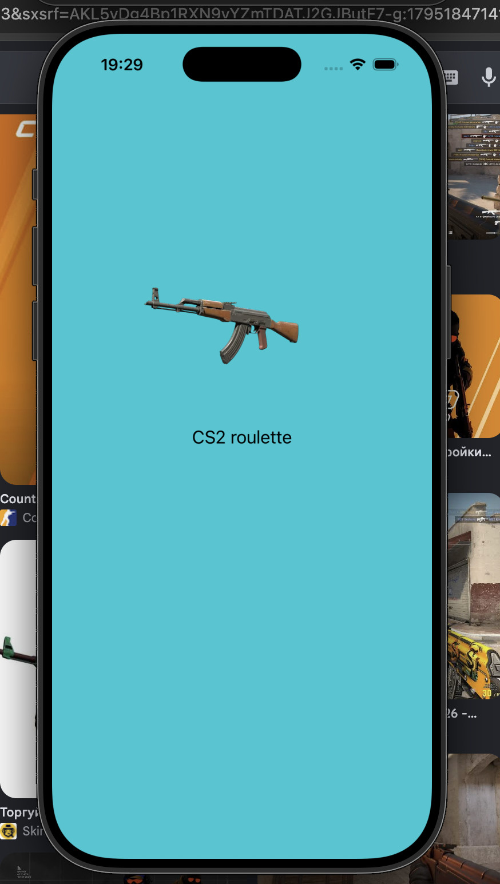
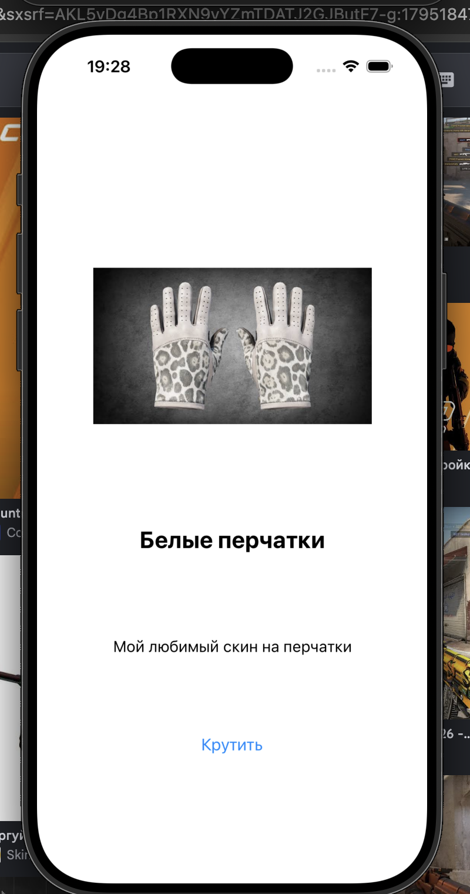
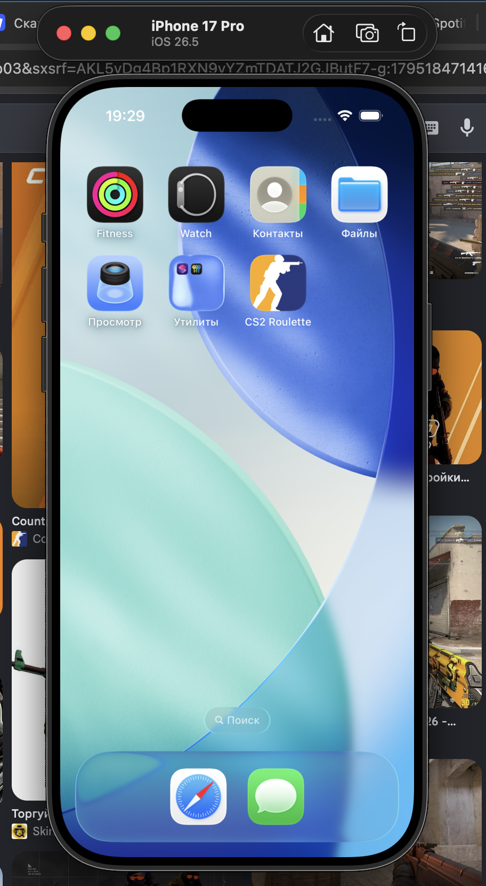

# CS2 Roulette

Одноэкранное iOS-приложение (UIKit, Storyboard, Swift). По нажатию на кнопку «Крутить» показывает случайную карточку из 10 моих любимых вещей из Counter-Strike 2: картинку, название и короткое описание. Одна и та же карточка не выпадает два раза подряд.

## Скриншоты

| Launch screen | Main screen | Home Screen с иконкой |
|---|---|---|
|  |  |  |

## Что внутри

- 10 избранных карточек хранятся в массиве структур `Favorite` (картинка, название, описание)
- Экран собран в `Main.storyboard` без Auto Layout (без constraints)
- Свои `LaunchScreen.storyboard` и иконка `AppIcon` 1024×1024
