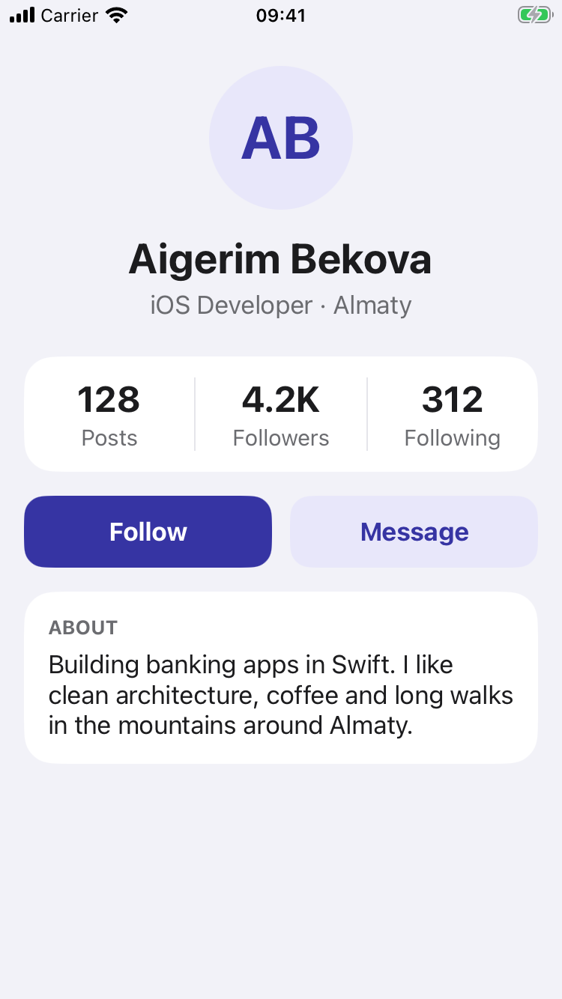
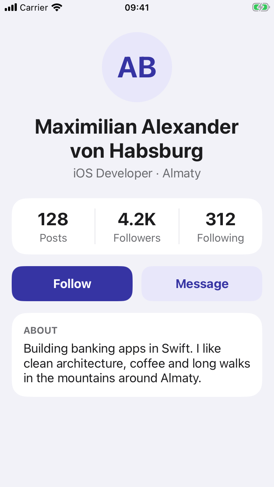
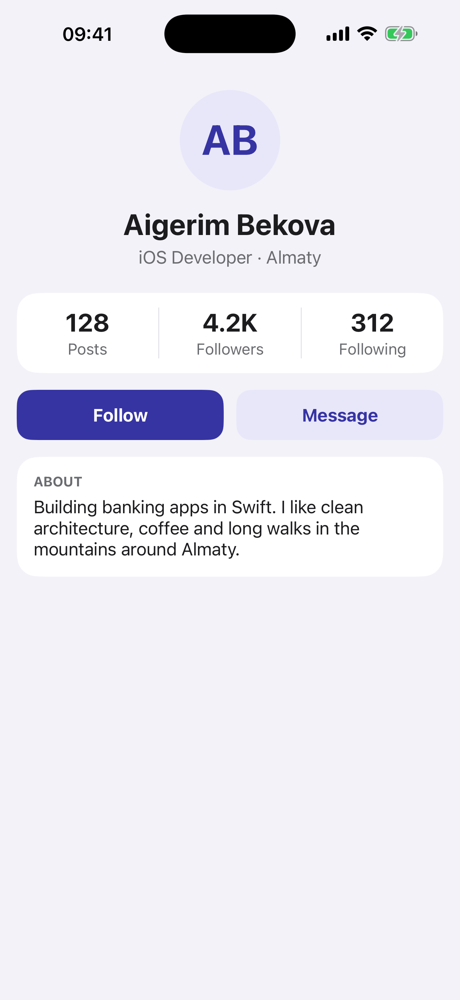
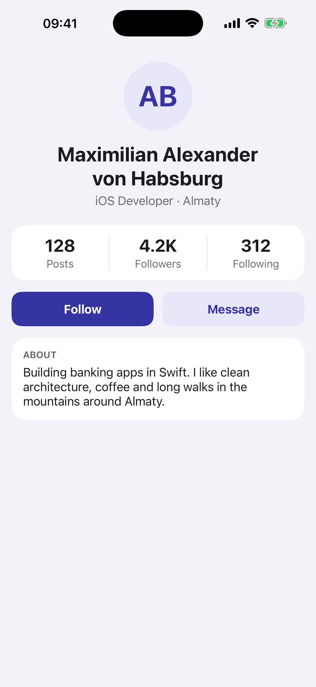

# Assignment 7 · Auto Layout — Variant A (Profile)

UIKit, Storyboard only. Every view and constraint is set in Interface Builder, no `UIStackView`,
and `ViewController.swift` contains no layout code.

## Implementation

- **Avatar:** 96 × 96, centered, circle (`layer.cornerRadius = 48` as a runtime attribute).
- **Name:** centered, up to 2 lines, font shrinks if needed.
- **Stats:** three columns with Equal Widths constraints and 1 pt dividers between them.
- **Follow / Message:** equal widths, 12 pt gap, 48 pt tall.
- **About:** label with no line limit, the card grows with the text.
- **Margins:** 16 pt on the sides, everything is pinned to the safe area.

## Screenshots

| Device | Default | Long name test |
|---|---|---|
| iPhone SE (3rd gen) |  |  |
| iPhone Pro Max (440 × 956 pt) |  |  |

Long name test: `Maximilian Alexander von Habsburg`.

> Pro Max screenshots were taken on the iPhone 17 Pro Max simulator, which has the same
> screen size as the iPhone 16 Pro Max.
