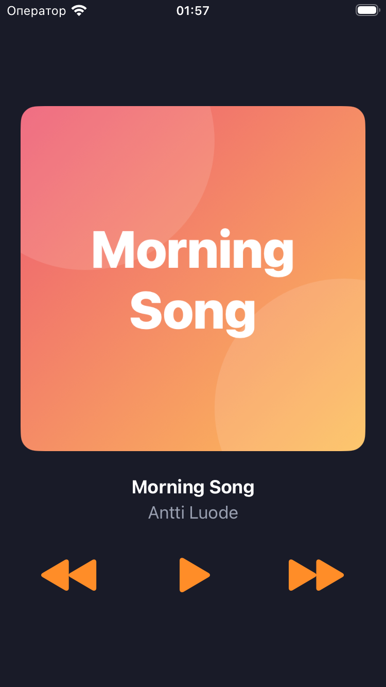
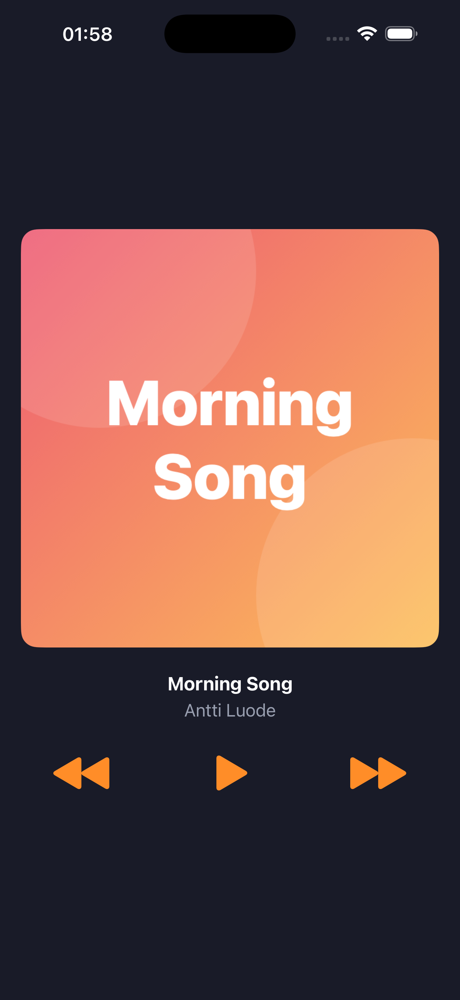

# Assignment 8 · Music Player — UIStackView & Auto Layout

Single-screen music player in UIKit. The layout is done in `Main.storyboard` only (no layout code),
and the tracks are real audio files from the app bundle played with `AVAudioPlayer`.

## Layout

- **Root `UIStackView`** (vertical, spacing 24) holds the cover, a labels stack and a controls stack.
  It is pinned to the Safe Area with 20 pt leading/trailing margins and centered vertically.
- **Cover:** `UIImageView` with a 1:1 aspect ratio constraint, so it stays square on every screen size.
- **Labels stack** (vertical, spacing 4): track title and artist.
- **Controls stack** (horizontal, Fill Equally, spacing 20): Previous, Play/Pause, Next
  (SF Symbols `backward.fill`, `play.fill` / `pause.fill`, `forward.fill`).
- Four stack views in total, no Auto Layout warnings in Interface Builder.

## Playback

- `Track` struct (`title`, `artist`, `fileName`, `coverImageName`); the track list lives in one place, `TrackLibrary`.
- 10 tracks in `Assignment8/Tracks` (added to the app target), one cover per track in `Assets.xcassets`.
- Audio is loaded with `Bundle.main.url(forResource:withExtension:)` and played with `AVAudioPlayer`.
- Play/Pause toggles playback and the icon. Next/Previous keep the play state and wrap around the list.
- `audioPlayerDidFinishPlaying` starts the next track automatically.
- A missing or broken file does not crash the app: it prints a message and shows an alert.
- The current track and the play state are kept in the view controller, and `updateUI()` redraws the screen from them.

## Screenshots

| iPhone SE (3rd gen) | iPhone Pro Max (440 × 956 pt) |
|---|---|
|  |  |

> Pro Max screenshot was taken on the iPhone 17 Pro Max simulator, which has the same
> screen size as the iPhone 16 Pro Max.

## Credits

- Music: **Antti Luode**, licensed under [CC BY 3.0](https://creativecommons.org/licenses/by/3.0/),
  via [Wikimedia Commons](https://commons.wikimedia.org/).
- Covers are generated gradients made for this project.
